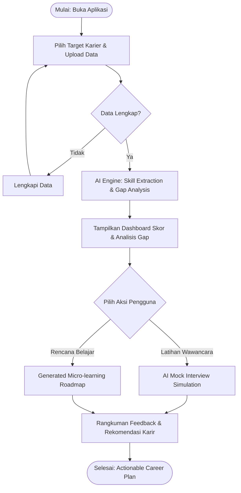

# 🧭 User Flow Prototipe

> Pemetaan perjalanan pengguna dalam menggunakan prototipe MVP dari awal hingga mendapatkan hasil akhir.

---

## 🚶‍♂️ Skenario Demo Utama (Happy Path)

1. **Step 1: Landing & Onboarding**
   - Pengguna membuka web app dan melihat pengantar singkat manfaat aplikasi.
   - Pengguna memilih role target atau mengunggah resume/profil.
2. **Step 2: AI Processing & Matching**
   - Sistem memproses data pengguna menggunakan AI model.
   - Tampilan loading interaktif menunjukkan transparansi proses analisis.
3. **Step 3: Visualisasi Hasil & Gap Analysis**
   - Pengguna disajikan dashboard kecocokan karier, radar skill, dan area peningkatan.
4. **Step 4: Interaksi Lanjutan (Fitur Interaktif)**
   - Pengguna mencoba fitur interaktif (misal: simulasi tanya-jawab AI atau rencana belajar).
5. **Step 5: Call to Action & Outcome**
   - Pengguna mendapatkan ringkasan action plan yang siap dieksekusi.

---

## 🗺️ Diagram Alur Pengguna (Mermaid Flowchart)

---

## ⚠️ Skenario Alternatif & Error Handling
- **Jika AI API timeout:** Tampilkan respons fallback yang telah disiapkan (cached result) agar demo tetap berjalan mulus.
- **Jika format input salah:** Tampilkan notifikasi validasi yang jelas tanpa membuat aplikasi crash.
