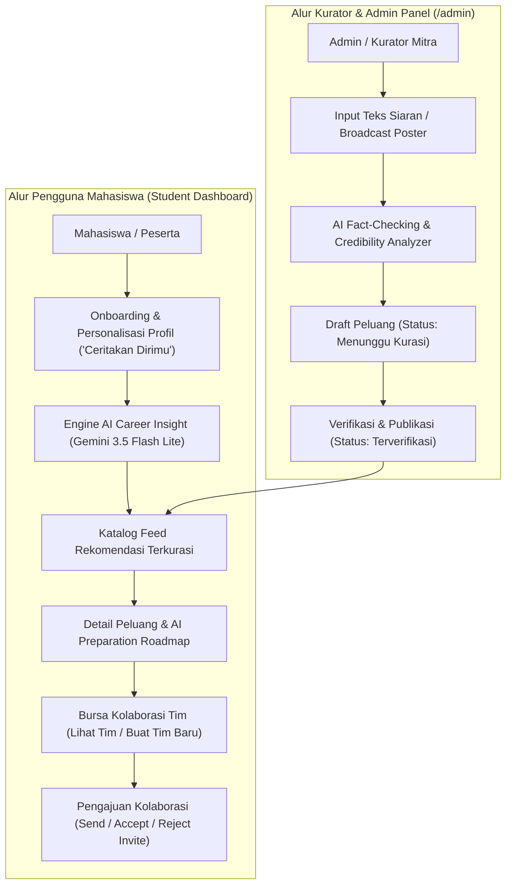

<div align="center">
  

  <br/>

  <a href="https://angkasa-mauve.vercel.app/" target="_blank">
    
  </a>
  

  <br/>

  
  
  
  
  
</div>

---

> **ANGKASA** adalah platform agregator peluang akademik dan kolaborasi talenta berbasis kecerdasan buatan (*AI-Powered Verified Opportunity & Team Aggregator*). Dirancang khusus bagi mahasiswa dan pelajar Indonesia, Angkasa menuntaskan permasalahan *information overload* dan risiko penipuan/hoaks lomba melalui kurasi ketat dua arah, pemetaan karir naratif otomatis, penyusunan lini masa persiapan terstruktur, serta bursa pencarian rekan tim yang terisolasi per kompetisi.

---

## Masalah & Proposisi Nilai

Mahasiswa dan pelajar di Indonesia menghadapi hambatan nyata dalam mengembangkan portofolio dan prestasi di luar kurikulum formal:

1. **Information Overload & Fragmentasi Sumber**  
   Ribuan informasi kompetisi, hackathon, beasiswa, dan seminar tersebar secara acak di media sosial dan grup siaran instan. Informasi penting sering terlewat karena tidak adanya sistem agregasi terpusat yang relevan dengan minat dan keahlian spesifik peserta.
2. **Risiko Hoaks, Penipuan, & Lomba Fiktif**  
   Meningkatnya ajang fiktif berbayar yang mengeksploitasi data pribadi peserta, memungut biaya pendaftaran ilegal, atau menyelenggarakan seleksi bodong tanpa kejelasan legalitas.
3. **Ketiadaan Peta Jalan Persiapan (Roadmap)**  
   Banyak mahasiswa urung mendaftar karena kebingungan memetakan langkah persiapan, dokumen administratif yang wajib dipenuhi, serta strategi teknis yang harus dieksekusi.
4. **Hambatan Pencarian Rekan Tim Lintas Keahlian**  
   Kesulitan mempertemukan kombinasi kompetensi yang solid (*Hacker, Hipster, Hustler*) pada cabang lomba tertentu tanpa tumpang-tindih peran dan konflik pendaftaran.

### Nilai Tambah yang Ditawarkan Angkasa:
- **Kurasi Terverifikasi Anti-Hoaks (*Segregation of Duties*)**: Setiap peluang wajib lolos verifikasi komparatif kecerdasan buatan dan validasi kurator manusia sebelum diterbitkan ke katalog publik.
- **AI Career & Skill Insight**: Cukup menuturkan latar belakang atau minat dalam bahasa natural; mesin *Google Gemini 3.5 Flash Lite* secara otomatis mengekstrak peran dominan, kompas karir, dan tag keahlian terstandarisasi.
- **AI Preparation Roadmap**: Menghasilkan rencana persiapan mandiri 4 pekan berbasis silabus ajang, lengkap dengan daftar periksa berkas administratif (*Checklist Tracker*).
- **Bursa Tim Terisolasi (*Context-Isolated Matchmaking*)**: Bursa pencarian rekan tim yang terikat ketat pada `opportunity.id`, memastikan kepastian peran tanpa konflik permohonan ganda.

---

## 3 Pilar Fitur Utama

| Pilar Fitur | Mekanisme & Arsitektur Teknologi | Dampak Nyata bagi Pengguna |
| :--- | :--- | :--- |
| **1. AI Career & Skill Insight** | **Google Gemini AI 3.5 Flash Lite (`@google/genai`)**<br>&bull; Analisis narasi bebas (*unstructured natural language processing*).<br>&bull; *Structured JSON Schema Output* untuk ekstraksi peran dominan (*Role*), kompas karir, dan arahan taktis.<br>&bull; *Dynamic Skill Extraction*: Menghasilkan daftar tag keahlian terstandarisasi yang otomatis menggantikan minat aktif.<br>&bull; *Dual-Mode Hybrid Fallback*: Mekanisme fallback heuristik lokal jika batas kuota API tercapai atau koneksi luring. | Mahasiswa tidak perlu mengisi formulir panjang yang kaku; cukup menceritakan pengalaman dan aspirasi untuk mendapatkan arahan karir dan katalog lomba yang presisi. |
| **2. Verified Curated Feed & AI Preparation Roadmap** | **Dual-Tier Verification & Generative Roadmap Engine**<br>&bull; Pemisahan wewenang (*Segregation of Duties*): Peluang baru masuk ke antrean draf kurator dan hanya tayang setelah diverifikasi sah.<br>&bull; *Fact-Checking Anti-Hoaks*: Analisis kredibilitas panitia penyelenggara dan transparansi biaya pendaftaran.<br>&bull; *Automated Weekly Roadmap*: Penyusunan rencana persiapan 4 pekan berbasis silabus dan kriteria lomba.<br>&bull; *Document Checklist Tracker*: Pelacak kelengkapan berkas administratif yang tersimpan lokal. | Menjamin 100% peluang di platform aman dari penipuan dan lomba fiktif, sekaligus memberi panduan persiapan mingguan agar tim siap bertanding optimal. |
| **3. Isolated Team Finding & Collaboration** | **Context-Isolated Team Bourse (`team_requests` & `team_invites`)**<br>&bull; Bursa pencarian tim yang terisolasi ketat per cabang perlombaan (`opportunity.id`).<br>&bull; Alur pengajuan kolaborasi (*Send Invite*) satu arah ke inisiator tim.<br>&bull; Panel persetujuan inisiator (*Accept / Reject Invite*).<br>&bull; Manajemen kelompok penuh: Pembatalan permohonan mandiri, *Kick Member*, dan *Delete Group*.<br>&bull; Pencegahan duplikasi tim aktif pada ajang yang sama. | Mengeliminasi friksi pencarian rekan tim dan memastikan mahasiswa dapat membentuk tim lintas disiplin yang terstruktur tanpa tumpang-tindih peran. |

---

## Arsitektur Sistem & Pemisahan Peran

ANGKASA menerapkan arsitektur *role-separated* yang memisahkan alur pengalaman mahasiswa (*Student Dashboard*) dan alur kurasi pengawas (*Curator & Admin Panel*):



### Penjelasan Pemisahan Peran:
- **Student Dashboard (`/`)**: Fokus pada penemuan peluang yang relevan dengan profil minat, pemantauan roadmap persiapan teknis, serta interaksi bursa pencarian rekan tim.
- **Curator & Admin Panel (`/admin`)**: Disediakan khusus bagi verifikator untuk meninjau draf siaran lomba, memverifikasi keabsahan penyelenggara, mengelola laporan pengguna, dan memantau analitik sebaran kompetisi.

---

## Tech Stack

- **Frontend Framework**: [Next.js 15 (App Router)](https://nextjs.org/) dengan *Turbopack Compiler*
- **Bahasa Pemrograman**: [TypeScript 5](https://www.typescriptlang.org/) (Strict Type-Checking)
- **Styling & Desain Sistem**: [Tailwind CSS](https://tailwindcss.com/) dengan tema *Royal Blue (`#004aad`)*, aksen *Amber Gold*, ornamen cyber modern, dan efek *Glassmorphism*
- **Komponen Ikon**: [Lucide React](https://lucide.dev/)
- **Artificial Intelligence**: Google Gemini API via `@google/genai` (Model utama: `gemini-3.5-flash-lite` dengan fallback ke `gemini-3.6-flash`)
- **Backend & Database**: [Supabase](https://supabase.com/) (PostgreSQL dengan Row Level Security & Supabase Auth Session)
- **State Management & Sinkronisasi**: Hybrid Client State, `localStorage` / `sessionStorage` fallback, dan Next.js Serverless API Route Handlers

---

## Struktur Direktori

```text
explorAItion-HACKATON/
├── public/                      # Aset statis & ilustrasi vektor fallback
│   ├── fallback-anime-poster.svg# Poster vektor cadangan lokal
│   └── ...
├── src/
│   ├── app/                     # Next.js App Router
│   │   ├── admin/               # Halaman Panel Kurator & Analitik Admin
│   │   │   └── page.tsx
│   │   ├── api/                 # Endpoint Serverless API Handlers
│   │   │   ├── analyze/         # Verifikasi siaran teks peluang (anti-hoaks)
│   │   │   ├── feed/            # Rekomendasi peluang terpersonalisasi
│   │   │   ├── profile-insight/ # Ekstraksi keahlian & kompas karir naratif
│   │   │   ├── roadmap/         # Penyusunan rencana persiapan 4 pekan
│   │   │   └── team/            # Pengelolaan tim & undangan kolaborasi
│   │   ├── globals.css          # Desain sistem & utilitas antarmuka
│   │   ├── layout.tsx           # Root layout aplikasi
│   │   └── page.tsx             # Titik masuk utama (Single Page Orchestrator)
│   ├── components/              # Komponen antarmuka modular
│   │   ├── auth/                # Modal autentikasi & tombol Demo 1-Klik
│   │   ├── BackgroundOrnaments.tsx # Ornamen visual latar belakang
│   │   ├── CuratorPanel.tsx     # Laci modal kurasi peluang mandiri
│   │   ├── FeedDashboard.tsx    # Katalog peluang & sistem pencarian/filter
│   │   ├── OpportunityDetail.tsx# Halaman detail lomba, roadmap, & bursa tim
│   │   └── ProfileView.tsx      # Manajemen profil minat & AI Career Insight
│   ├── lib/                     # Abstraksi data & integrasi pihak ketiga
│   │   ├── apiClient.ts         # Abstraksi pemanggilan API & sinkronisasi Supabase
│   │   ├── mockData.ts          # Dataset mock luring cadangan demo
│   │   └── supabaseClient.ts    # Inisialisasi koneksi klien Supabase
│   └── types/                   # Definisi tipe & kontrak data
│       └── schema.ts            # Skema TypeScript terpadu
├── AGENTS.md                    # Aturan disiplin kerja & batasan repositori tim
├── package.json                 # Konfigurasi dependensi dan skrip proyek
└── README.md                    # Dokumentasi utama proyek
```

---

## Panduan Instalasi Lokal

Ikuti langkah-langkah berikut untuk menjalankan ANGKASA di lingkungan lokal:

### 1. Prasyarat Sistem
- **Node.js**: Versi 18.18.0 atau yang lebih baru (disarankan Node.js v20 LTS).
- **npm** (atau yarn / pnpm / bun).
- Kunci API Google Gemini (dapat diperoleh secara gratis melalui [Google AI Studio](https://aistudio.google.com/)).

### 2. Kloning Repositori
```bash
git clone https://github.com/4asec/explorAItion.git
cd explorAItion
```

### 3. Instalasi Dependensi
```bash
npm install
```

### 4. Konfigurasi Environment Variables
Buat berkas `.env.local` di direktori *root* proyek dan sesuaikan nilainya:

```env
# Kredensial Supabase (Opsional jika ingin sinkronisasi penuh database cloud)
NEXT_PUBLIC_SUPABASE_URL=https://your-project.supabase.co
NEXT_PUBLIC_SUPABASE_ANON_KEY=your-anon-key

# Google Gemini API Key (Wajib untuk menjalankan fitur AI secara aktif)
GEMINI_API_KEY=your-gemini-api-key
```

> **Catatan Pengujian:** Apabila `GEMINI_API_KEY` tidak diisi atau kuota API habis, sistem ANGKASA secara cerdas mengaktifkan *offline heuristic fallback* sehingga presentasi dan pengujian antarmuka tetap berjalan lancar tanpa mengalami kendala layar kosong (*crash*).

### 5. Menjalankan Server Pengembangan
```bash
npm run dev
```

Buka peramban web dan navigasikan ke:
```text
http://localhost:3000
```

### 6. Akses Panel Kurator & Admin
Untuk mengakses antarmuka kurator dan verifikator peluang anti-hoaks, buka:
```text
http://localhost:3000/admin
```

---

## Akun Demo untuk Pengujian Cepat

Untuk mempermudah dewan juri dan penguji dalam mengevaluasi alur kerja aplikasi secara langsung:
- **Masuk Akun Demo (1-Klik)**: Tersedia tombol instan *"Masuk Akun Demo 1-Klik"* di halaman autentikasi awal yang langsung mengarahkan pengguna ke halaman personalisasi profil dan feed cerdas tanpa perlu mendaftar email secara manual.
- **Role Switcher**: Tersedia simulasi peran mahasiswa dan akses panel kurator di `/admin` untuk menguji pemisahan wewenang secara komprehensif.

---

## Tim Pengembang

Proyek **ANGKASA** dikembangkan oleh tim mahasiswa **D4 Teknik Informatika, Jurusan Teknologi Informasi — Politeknik Negeri Malang**:

- **Muhammad Raffa Danendra** &bull; *Hacker (AI Architecture & Backend Engineering)*
- **Muhammad Iqbal Bayuaji** &bull; *Hipster (UI/UX Design & Frontend Engineering)*
- **Revaldo** &bull; *Hustler (Product Strategy & Pitch Lead)*
- **Aldo** &bull; *Team Contributor*

---

<p align="center">
  <strong>ANGKASA &bull; EXPLOR[AI]TION HACKATHON 2026</strong><br>
  <em>Membuka Cakrawala Prestasi dan Kolaborasi Talenta Muda Indonesia</em>
</p>